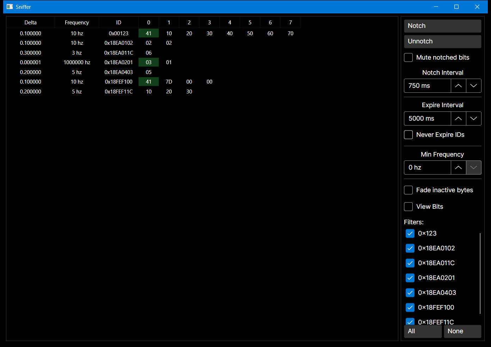
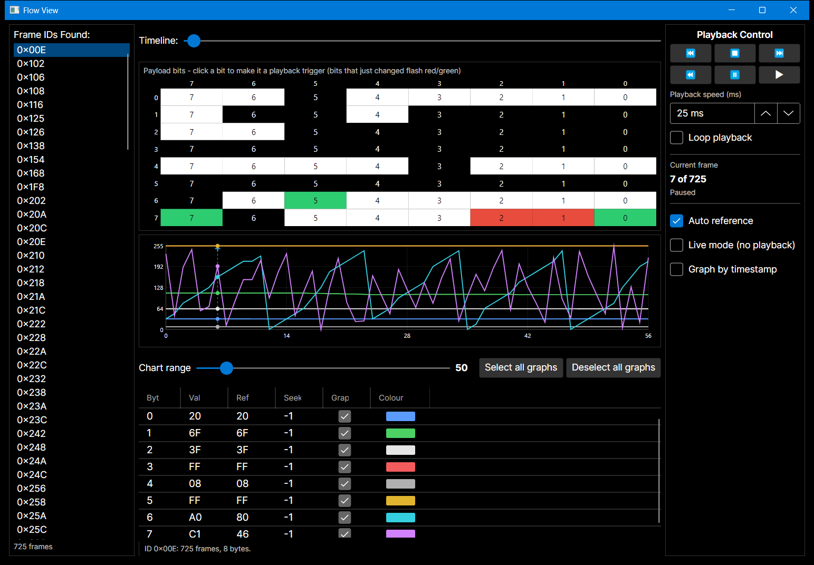
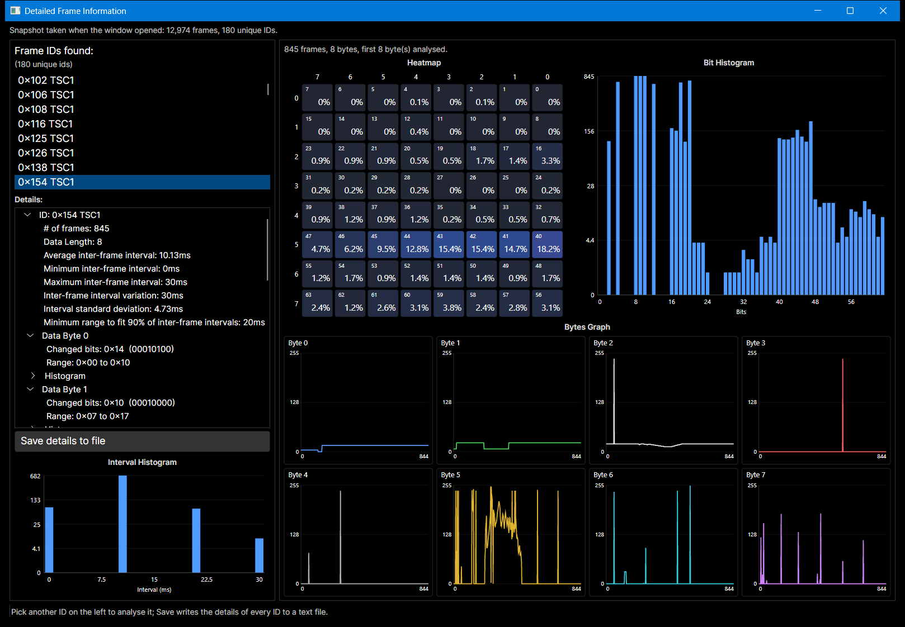
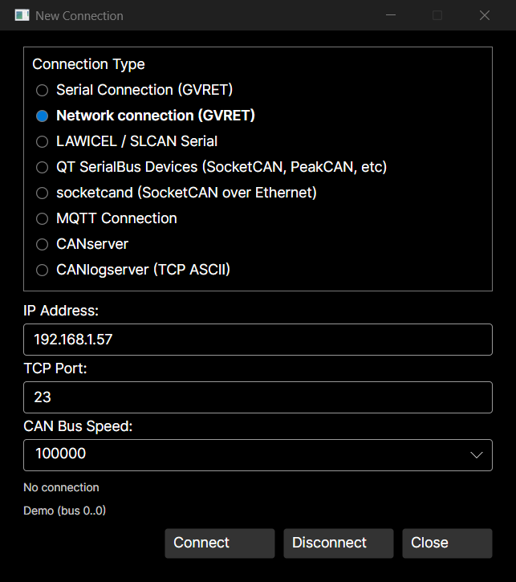

# CanYeAye

CanYeAye is a modern, cross-platform reimplementation of
[SavvyCAN](https://github.com/collin80/SavvyCAN) built on **.NET 10** and **Avalonia**.
It captures, records, decodes and analyses CAN bus traffic while keeping SavvyCAN's log
formats, DBC support, connection types and JavaScript scripting API — with a redesigned UI,
a cansniffer-style analysis view and an interactive J1939 node graph.


## Features

### Frame view and filtering
- Live capture and log playback in one grid: time (local wall clock), bus, type, count, ID,
  **source → destination nodes**, length, ASCII and space-delimited hex data, plus optional
  DBC interpretation expanded inside the row.
- Zebra-striped rows, reorderable/resizable/hideable columns, overwrite mode with per-ID
  counts and deltas, suspend, auto-scroll, clear, keep-filters option and 10 % zoom steps.
- Frame filter pane with two tabs: a **sorted per-ID** include/exclude list (with search,
  All/None) and a **J1939 Nodes** tab for naming source nodes, bulk-selecting all of a node's
  IDs (mixed = dash), a **Broadcast** row covering every broadcast destination, and
  Load/Save/Reset for node-name files. The pane docks into the main window on the left or
  right (the grid resizes around it) or floats in its own window.

### Files, DBC and connections
- Reads and writes native GVRET CSV, CRTD, BusMaster, Microchip, Vector TRC, IXXAT, CAN-DO,
  Vehicle Spy, candump, Lawicel, PCAN, CANalyzer ASC, CARBUS, CANHacker, Cabana, Kvaser,
  CANalyzer **BLF**, **pcap/pcapng**, Tesla AP snapshots, CANServer and CLX000 logs.
- DBC manager with multi-file load/reorder, message/signal decoding, J1939 and GMLAN support.
- Connections: GVRET serial and network (TCP port 23), LAWICEL/SLCAN, **PEAK PCAN-USB**
  (classic CAN through the PCAN-Basic API, with channel detection: PEAK's `PCANBasic.dll` on
  Windows, MacCAN's `libPCBUSB.dylib` on macOS, `libpcanbasic.so` on Linux), socketcand, MQTT,
  CANserver and CANlogserver, with passive UDP discovery. Vector XL remains behind an
  interface for its Windows vendor DLL.
- Send-frame window for arbitrary classic/CAN-FD frames.

### Analysis
- **Sniffer**: cansniffer-style live view with Delta/Frequency/ID/byte columns, green/red
  change highlighting, notching, mute-notched, fade-inactive bytes, bit view (green = 1,
  red = 0 cells with white outlines), expiry and a minimum-rate (Hz) filter. Its ID filters
  are seeded from the main window when it opens; newly seen IDs appear checked by default.
- **Flow View** (Tools → Flow View…): pick any captured ID (main filters are ignored) and
  step or play through its frames. Payload bits fill a full-width black/white grid where
  changed bits flash red/green, with auto or editable reference bytes, per-byte seek values
  that stop playback on a match, clickable trigger bits, a live/capture byte graph with a
  scrollable frame range, and a per-byte `Graph?` toggle, speed and loop controls.
- **J1939 node graph** (Tools → Node Graph…): conversations between named source nodes with
  edge thickness proportional to traffic, a broadcast bar, top talkers, hover details, drag
  to rearrange, wheel/pinch zoom and pan, and long-press/double-click node naming. Works from
  live traffic or a one-off snapshot of the loaded capture.
- **Detailed Frame Information** (Tools → Detailed Frame Information…): a one-off snapshot of
  the loaded capture for one ID: per-byte ranges, changed-bit masks, value histograms and
  per-byte graphs, a bit-change heatmap, bit and inter-frame-interval histograms, J1939/GMLAN
  decoding and DBC signal value counts, savable as tab-indented text. The window never follows
  live traffic; reopen it to refresh.
- ISO-TP, UDS and OBD-II tools, including a live OBD-II poller.

### Scripting
- SavvyCAN `.js` scripts run unmodified on [Jint](https://github.com/sebastienros/jint)
  through the `host`, `can`, `isotp` and `uds` globals.

## Screenshots


*J1939 node graph: named nodes, weighted bidirectional conversations, broadcast bar and top
talkers.*



*Sniffer: per-ID delta and frequency, changed bytes highlighted, notching and filters.*



*Flow View: full-width payload bits with red/green change flashes, per-byte graph, reference,
seek and trigger controls.*



*Detailed Frame Information: per-byte heatmap and value graphs, bit histogram, interval
histogram, J1939/GMLAN decoding and DBC signal histograms for one ID of a frozen capture.*



*Connection dialog: connection type list with per-type settings (GVRET network shown).*

## Getting started

Requirements: the **.NET 10 SDK** (pinned by `global.json`, currently 10.0.404) and a
desktop supported by Avalonia (Windows 10/11, macOS 13+ on Apple silicon or Intel, or a Linux
desktop). Vendor drivers are only needed for their hardware:

| Adapter | Windows | macOS | Linux |
|---|---|---|---|
| PEAK PCAN-USB | PEAK driver (`PCANBasic.dll`) | [MacCAN PCBUSB](https://www.mac-can.com) (`libPCBUSB.dylib` in `/usr/local/lib`) | PEAK `pcan` driver + `libpcanbasic.so` |
| Vector XL (connection not implemented yet) | Vector driver (`vxlapi64.dll`) | not available (Vector ships no macOS driver) | not available |

GVRET, LAWICEL/SLCAN, socketcand, MQTT, CANserver and CANlogserver need no vendor driver on
any platform. On macOS, serial adapters appear as `/dev/cu.usbmodem…` / `/dev/cu.usbserial…`.

```powershell
dotnet build
dotnet test --nologo -v q
dotnet run --project src/CanYeAye.App

# open a log (and optional DBC files) at startup
dotnet run --project src/CanYeAye.App -- path\to\capture.csv path\to\database.dbc
```

CanYeAye keeps its own settings at `%APPDATA%\CanYeAye\settings.json` (Windows),
`~/Library/Application Support/CanYeAye/settings.json` (macOS) or `~/.config/CanYeAye/settings.json`
(Linux); it never reads or writes SavvyCAN's QSettings registry keys.

On macOS the menus live in the global menu bar (Quit is in the CanYeAye application menu) and
shortcuts use Cmd instead of Ctrl (Open ⌘O, Save ⌘S, Connection ⌘K, Zoom ⌘= / ⌘- / ⌘0).
macOS also gets an About item in the application menu; Tools → About CanYeAye… opens the same
About box on every platform.
To build a double-clickable `CanYeAye.app` (ad-hoc signed, not notarized):

```bash
build/macos/package-app.sh            # -> artifacts/macos/CanYeAye.app and canyeaye-osx-arm64.zip
xattr -dr com.apple.quarantine CanYeAye.app   # only needed for a downloaded copy
```

## CI and releases

`.github/workflows/build.yml` runs **only when a tag matching `v*` is pushed** — branch pushes
and pull requests do not build. Pushing a tag builds and tests the commit, publishes
self-contained **win-x64** (zip), **linux-x64** (tar.gz) and **osx-arm64** (`CanYeAye.app` in a
zip) packages and creates the GitHub
Release for that tag with the generated notes. The tag without its leading `v` is used as the
assembly/package version:

```powershell
git tag v0.1.3
git push origin v0.1.3
```

## Compatibility and attribution

- Log formats, DBC files, project/settings semantics and the scripting API follow SavvyCAN.
  CanYeAye is an independent port and is not affiliated with the SavvyCAN project.
- SavvyCAN is MIT licensed (Collin Kidder and contributors). CanYeAye's frame model derives
  from SavvyCAN's `can_structs.h`, which in turn derives from Qt's `QCanBusFrame`
  (LGPL/GPL family); see `AGENTS.md` for the licensing note before distributing binaries.
- Development notes and the reference protocol research live in `AGENTS.md` and `docs/research/`.


