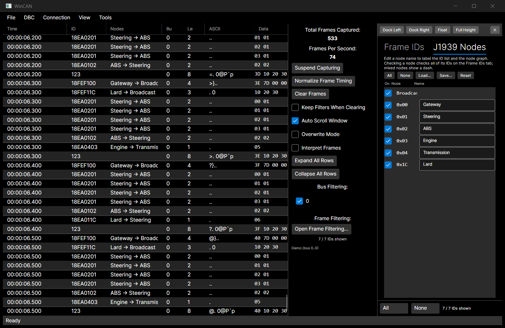
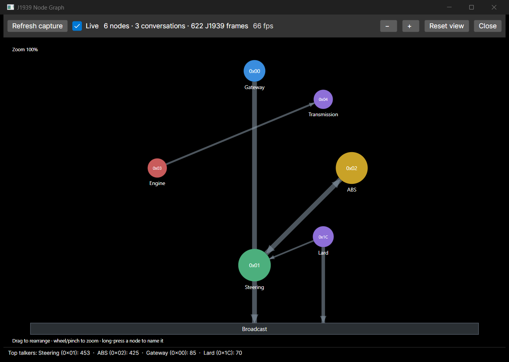

# WinCAN

WinCAN is a modern, cross-platform reimplementation of
[SavvyCAN](https://github.com/collin80/SavvyCAN) built on **.NET 10** and **Avalonia**.
It captures, records, decodes and analyses CAN bus traffic while keeping SavvyCAN's log
formats, DBC support, connection types and JavaScript scripting API — with a redesigned UI,
a cansniffer-style analysis view and an interactive J1939 node graph.



## Features

### Frame view and filtering
- Live capture and log playback in one grid: time (local wall clock), bus, type, count, ID,
  **source → destination nodes**, length, ASCII and space-delimited hex data, plus optional
  DBC interpretation expanded inside the row.
- Zebra-striped rows, reorderable/resizable/hideable columns, overwrite mode with per-ID
  counts and deltas, suspend, auto-scroll, clear, keep-filters option and 10 % zoom steps.
- Frame filter pane with two tabs: a **sorted per-ID** include/exclude list (with search,
  All/None) and a **J1939 Nodes** tab for naming source nodes, bulk-selecting all of a node's
  IDs (mixed = dash), a **Broadcast** row covering every broadcast destination, and
  Load/Save/Reset for node-name files. The pane docks into the main window on the left or
  right (the grid resizes around it) or floats in its own window.

### Files, DBC and connections
- Reads and writes native GVRET CSV, CRTD, BusMaster, Microchip, Vector TRC, IXXAT, CAN-DO,
  Vehicle Spy, candump, Lawicel, PCAN, CANalyzer ASC, CARBUS, CANHacker, Cabana, Kvaser,
  CANalyzer **BLF**, **pcap/pcapng**, Tesla AP snapshots, CANServer and CLX000 logs.
- DBC manager with multi-file load/reorder, message/signal decoding, J1939 and GMLAN support.
- Connections: GVRET serial and network (TCP port 23), LAWICEL/SLCAN, socketcand, MQTT,
  CANserver and CANlogserver, with passive UDP discovery. PCAN-Basic and Vector XL are kept
  behind interfaces for Windows vendor DLLs.
- Send-frame window for arbitrary classic/CAN-FD frames.

### Analysis
- **Sniffer**: cansniffer-style live view with Delta/Frequency/ID/byte columns, green/red
  change highlighting, notching, mute-notched, fade-inactive bytes, bit view, expiry and a
  minimum-rate (Hz) filter.
- **J1939 node graph** (Tools → Node Graph…): conversations between named source nodes with
  edge thickness proportional to traffic, a broadcast bar, top talkers, hover details, drag
  to rearrange, wheel/pinch zoom and pan, and long-press/double-click node naming. Works from
  live traffic or a one-off snapshot of the loaded capture.
- ISO-TP, UDS and OBD-II tools, including a live OBD-II poller.

### Scripting
- SavvyCAN `.js` scripts run unmodified on [Jint](https://github.com/sebastienros/jint)
  through the `host`, `can`, `isotp` and `uds` globals.

## Screenshots



*J1939 node graph: named nodes, weighted bidirectional conversations, broadcast bar and top
talkers.*


*Sniffer: per-ID delta and frequency, changed bytes highlighted, notching and filters.*


*Connection dialog: connection type list with per-type settings (GVRET network shown).*

## Getting started

Requirements: the **.NET 10 SDK** (pinned by `global.json`, currently 10.0.404) and a
desktop supported by Avalonia (Windows 10/11 or a Linux desktop). PCAN-Basic / Vector XL
hardware also needs the vendor DLLs on Windows.

```powershell
dotnet build
dotnet test --nologo -v q
dotnet run --project src/WinCAN.App

# open a log (and optional DBC files) at startup
dotnet run --project src/WinCAN.App -- path\to\capture.csv path\to\database.dbc
```

WinCAN keeps its own settings at `%APPDATA%\WinCAN\settings.json`; it never reads or writes
SavvyCAN's QSettings registry keys.

## CI and releases

`.github/workflows/build.yml` builds and tests every pull request and push to `main`. On
`main` it also publishes self-contained **win-x64** (zip) and **linux-x64** (tar.gz) packages
and creates a GitHub Release tagged `v0.1.<run_number>` with the generated notes. A manual
run from the Actions tab on `main` cuts a release too.

## Compatibility and attribution

- Log formats, DBC files, project/settings semantics and the scripting API follow SavvyCAN.
  WinCAN is an independent port and is not affiliated with the SavvyCAN project.
- SavvyCAN is MIT licensed (Collin Kidder and contributors). WinCAN's frame model derives
  from SavvyCAN's `can_structs.h`, which in turn derives from Qt's `QCanBusFrame`
  (LGPL/GPL family); see `AGENTS.md` for the licensing note before distributing binaries.
- Development notes and the reference protocol research live in `AGENTS.md` and `docs/research/`.
